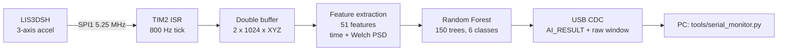

# STM32 Real-Time Vibration Fault Classification (TinyML)

On-device predictive-maintenance node for the **STM32F407G-DISC1**: the board samples its on-board
**LIS3DSH** accelerometer at **800 Hz**, extracts 51 time- and frequency-domain features from each
1.28 s window and classifies the machine state with a **150-tree Random Forest that runs entirely on
the Cortex-M4F** — no PC, no cloud. Raw data and predictions are streamed to a PC over USB CDC.


## Highlights

- **Bare-metal-style sensor driver** for the LIS3DSH over SPI1 (WHO_AM_I check, 800 Hz ODR, BDU, ±2 g).
- **Deterministic sampling**: TIM2 interrupt at exactly 800 Hz, double-buffered 1024-sample windows,
  missed-sample and dropped-window counters.
- **Feature extraction in C that matches SciPy**: RMS, peak-to-peak, crest factor, kurtosis, dominant
  frequency, total power and 11 band powers per axis. Verified against
  `scipy.signal.welch` / `scipy.stats.kurtosis` — **max relative error 6 × 10⁻⁸** (see [tests](#tests)).
- **Random Forest exported to plain C arrays** (150 trees, 3 412 nodes, 6 classes) plus a
  logistic-regression baseline; no runtime library needed.
- **USB CDC virtual COM port** instead of UART (the DISC1 ST-LINK does not bridge USART2 to the PC).
- CI: firmware cross-compiled with `arm-none-eabi-gcc` and host tests on every push.

## Architecture



## Resource usage (GCC 13.2, `-O2`)

| Item | Size |
|---|---|
| Total Flash | 172 KB / 1 MB (16 %) |
| Total RAM | 34.5 KB / 128 KB (26 %) |
| Random Forest tables (Flash) | ~137 KB |
| Sampling double buffer (RAM) | 12 KB |
| Feature-extraction scratch (RAM) | 12.2 KB |
| Inference time | reported by firmware as `inference_ms` — **TODO: fill in measured value** |

> The PSD currently uses a direct reference DFT in double precision so that features match the Python
> training pipeline exactly. It is correct but slow; the next step is replacing it with CMSIS-DSP
> `arm_rfft_fast_f32` and re-verifying against the same SciPy reference.

## Repository layout

```
firmware/                     STM32CubeIDE project (PM_EDGE_NODE_V2.ioc)
  Core/Src/main.c             init, main loop, USB reporting
  Drivers/LIS3DSH/            accelerometer driver (SPI)
  Services/Sampling/          800 Hz double-buffered window acquisition
  Services/Inference/         feature extraction + RF / LR classifiers
    generated/pm_models_data.h   model exported from Python
  Makefile                    standalone GCC build (no IDE needed)
tools/serial_monitor.py       read USB CDC output, print predictions, save labelled windows
tests/host/                   C-vs-SciPy numerical test of the feature extractor
data/sample/                  raw SWV/ITM capture from the board (still, 1 g on Z)
```

## Build & flash

**STM32CubeIDE:** *File → Import → Existing Projects into Workspace →* select `firmware/`, then build and run.

**Command line:**

```bash
sudo apt install gcc-arm-none-eabi libnewlib-arm-none-eabi stlink-tools
make -C firmware          # -> firmware/build/pm_edge_node.elf / .bin
make -C firmware flash    # st-flash to 0x08000000
```

Connect the board's **micro-USB (USB OTG FS, CN5)** port to the PC — it appears as a virtual COM port.

## Run

```bash
pip install -r tools/requirements.txt
python tools/serial_monitor.py --port COM5                        # Windows
python tools/serial_monitor.py --port /dev/ttyACM0 --save run.csv --label 1.1
```

Example output:

```
window=    1 samples=1024 missed=0 dropped=0 -> class 1.3 (... ms)
```

### Serial protocol

```
WINDOW <n> | samples=1024 | missed=<m> | dropped=<d>
<index>,<x>,<y>,<z>                         # 1024 rows, raw LIS3DSH counts (16384 = 1 g)
AI_RESULT window=<n> class=1.<c> inference_ms=<t>
```

## Classes

| Label | Meaning |
|---|---|
| 1.1 – 1.6 | **TODO: describe each machine condition** |

## Tests

```bash
pip install -r tests/host/requirements.txt
make -C tests/host test       # compiles pm_inference.c for the PC and compares with SciPy
cd tools && python -m pytest  # serial protocol parser
```

```
features compared: 51
max relative error: 5.91e-08
PASS
```

## Roadmap

- [ ] CMSIS-DSP FFT for the PSD (target: real-time inference, no sampling pause)
- [ ] Int8 1D-CNN / autoencoder variant via TFLite Micro or X-CUBE-AI; compare against the RF
- [ ] LED status (LD4 normal / LD5 fault) on the board
- [ ] DMA-based SPI multi-byte reads

## License

MIT for the original code — see [LICENSE](LICENSE). ST HAL, CMSIS and the USB Device Library keep
their own licenses.
