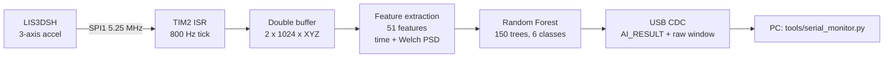

# STM32 Real-Time Vibration Classification (TinyML)

On-device predictive-maintenance node for the **STM32F407G-DISC1**: the board samples its on-board
**LIS3DSH** accelerometer at **800 Hz**, extracts 51 time- and frequency-domain features from each
1.28 s window and classifies the machine state with a **150-tree Random Forest that runs entirely on
the Cortex-M4F** — inference needs no host computer or cloud. Demo task: recognising the fan level
(6 levels) of a desktop PC from its vibration. Raw data and predictions are streamed over USB CDC.


## Highlights

- **Bare-metal-style sensor driver** for the LIS3DSH over SPI1 (WHO_AM_I check, 800 Hz ODR, BDU, ±2 g).
- **Deterministic sampling**: TIM2 interrupt at exactly 800 Hz, double-buffered 1024-sample windows,
  missed-sample and dropped-window counters.
- **Feature extraction in C that matches SciPy**: RMS, peak-to-peak, crest factor, kurtosis, dominant
  frequency, total power and 11 band powers per axis. Verified against
  `scipy.signal.welch` / `scipy.stats.kurtosis` — **max relative error 6 × 10⁻⁸** (see [tests](#tests)).
- **Random Forest exported to plain C arrays** (150 trees, 6 classes) plus a logistic-regression
  baseline; no runtime library needed. **84.4 % holdout / 82.2 % 5-fold CV accuracy** on 6 fan levels.
- **Full pipeline in the repo**: data collection script, raw dataset, training/export script.
- **USB CDC virtual COM port** instead of UART (the DISC1 ST-LINK does not bridge USART2 to the PC).
- CI: firmware cross-compiled with `arm-none-eabi-gcc` and host tests on every push.

## Architecture



## Resource usage (GCC 13.2, `-O2`)

| Item | Size |
|---|---|
| Total Flash | 172 KB / 1 MB (16 %) |
| Total RAM | 34.5 KB / 128 KB (26 %) |
| Random Forest tables (Flash) | ~137 KB |
| Sampling double buffer (RAM) | 12 KB |
| Feature-extraction scratch (RAM) | 12.2 KB |
| Inference time | reported by firmware as `inference_ms` — **TODO: fill in measured value** |

> The PSD currently uses a direct reference DFT in double precision so that features match the Python
> training pipeline exactly. It is correct but slow; the next step is replacing it with CMSIS-DSP
> `arm_rfft_fast_f32` and re-verifying against the same SciPy reference.

## Repository layout

```
firmware/                     STM32CubeIDE project (PM_EDGE_NODE_V2.ioc)
  Core/Src/main.c             init, main loop, USB reporting
  Drivers/LIS3DSH/            accelerometer driver (SPI)
  Services/Sampling/          800 Hz double-buffered window acquisition
  Services/Inference/         feature extraction + RF / LR classifiers
    generated/pm_models_data.h   model exported from Python
  Makefile                    standalone GCC build (no IDE needed)
training/
  features.py                 Python twin of the C feature extractor
  train.py                    CV evaluation, RF + LR training, export to C header
tools/
  collect_dataset.py          record labelled windows from the board to CSV
  serial_monitor.py           live predictions + optional CSV logging
  check_port.py               list ports / sanity-check the stream
tests/host/                   C-vs-Python numerical test of the feature extractor
data/raw/class_1.x.csv        6 classes x 30 windows x 1024 samples (800 Hz, raw counts)
data/raw/pilot_20261015/      earlier unlabelled pilot sessions
data/sample/                  raw SWV/ITM capture from the board (still, 1 g on Z)
```

## Build & flash

**STM32CubeIDE:** *File → Import → Existing Projects into Workspace →* select `firmware/`, then build and run.

**Command line:**

```bash
sudo apt install gcc-arm-none-eabi libnewlib-arm-none-eabi stlink-tools
make -C firmware          # -> firmware/build/pm_edge_node.elf / .bin
make -C firmware flash    # st-flash to 0x08000000
```

Connect the board's **micro-USB (USB OTG FS, CN5)** port to the PC — it appears as a virtual COM port.

## Run

```bash
pip install -r tools/requirements.txt
python tools/serial_monitor.py --port COM5                        # Windows
python tools/serial_monitor.py --port /dev/ttyACM0 --save run.csv --label 1.1
```

Example output:

```
window=    1 samples=1024 missed=0 dropped=0 -> class 1.3 (... ms)
```

### Serial protocol

```
WINDOW <n> | samples=1024 | missed=<m> | dropped=<d>
<index>,<x>,<y>,<z>                         # 1024 rows, raw LIS3DSH counts (16384 = 1 g)
AI_RESULT window=<n> class=1.<c> inference_ms=<t>
```

## Data & training

**Task:** classify the fan level of a desktop PC (CPU, GPU and system fans) from the vibration
measured by the board. Data was recorded with `tools/collect_dataset.py`:
**6 levels x 30 windows x 1024 samples** (180 windows, 800 Hz, ~38 s per level).

| Class | Fan level | CPU fan (RPM) | GPU fan (RPM) | System fan (RPM) |
|---|---|---|---|---|
| 1.1 | 1 - lowest | 2700 | 3300 | 4300 |
| 1.2 | 2 | 3600 | 3900 | 4900 |
| 1.3 | 3 | 4200 | 4700 | 5600 |
| 1.4 | 4 | 5000 | 5500 | 5800 |
| 1.5 | 5 - one below max | 5500 | 6200 | 6700 |
| 1.6 | 6 - max fan mode | 6000 | 6600 | 7400 |

Mean of 30 windows per level (raw counts, mean removed per axis; combined = sqrt(X²+Y²+Z²)):

| Class | X RMS | Y RMS | Z RMS | Combined RMS | Dominant freq. |
|---|---|---|---|---|---|
| 1.1 | 88.25 | 43.04 | 68.58 | 119.8 | 85.9 Hz |
| 1.2 | 88.31 | 42.60 | 68.06 | 119.4 | 85.9 Hz |
| 1.3 | 93.01 | 43.43 | 70.63 | 124.6 | 85.2 Hz |
| 1.4 | 89.44 | 43.34 | 70.03 | 121.6 | 89-91 Hz |
| 1.5 | 95.61 | 42.81 | 70.73 | 126.4 | 85.9 Hz |
| 1.6 | 128.27 | 48.50 | 94.02 | 166.3 | 116.4 Hz |

Vibration energy barely changes across levels 1-5 and only jumps at max fan mode (+31.5 % combined
RMS vs. 1.5, +38.8 % vs. 1.1), where the dominant frequency also moves from ~86 Hz to 116 Hz. Levels
1-5 must therefore be separated by finer **spectral** detail: the most important features are Z-axis
band power at 95-110 Hz, the Z dominant frequency, X crest factor and the 250-350 Hz band.

```bash
pip install -r training/requirements.txt
python training/train.py            # evaluate + export to training/output/
python training/train.py --deploy   # also overwrite the firmware model header
```

**Reproducible:** with `scikit-learn==1.8.0`, `train.py` regenerates the firmware model header
(`pm_models_data.h`) **bit-for-bit**; CI checks this on every push. The C implementation running
the exported tables reproduces scikit-learn's predictions on 180/180 windows.

### Results

| Model | Holdout acc. (25 %, 45 windows) | Macro F1 | 5-fold CV acc. |
|---|---|---|---|
| **Random Forest** (150 trees, depth 5) - deployed | **84.4 %** | 0.837 | 82.2 % |
| Logistic Regression | 77.8 % | 0.773 | 78.9 % |
| MLP (24-12) | 75.6 % | 0.740 | 75.6 % |

```
RF holdout confusion matrix (rows = true, cols = predicted)
      1.1 1.2 1.3 1.4 1.5 1.6
1.1 [  7   0   0   0   0   0]
1.2 [  4   3   0   0   0   0]
1.3 [  0   0   7   0   1   0]
1.4 [  1   0   0   7   0   0]
1.5 [  0   0   1   0   7   0]
1.6 [  0   0   0   0   0   7]
```

The hardest pair is levels 1 and 2 (lowest RPM, smallest vibration difference); the highest level is
always recognised.

**Limitations.** Each level was recorded in a single session, so window-level splits are not
independent-session validation and the scores above are exploratory. The next dataset should
contain several sessions per level, evaluated with leave-one-session-out.

## Tests

```bash
pip install -r training/requirements.txt
make -C tests/host test       # compiles pm_inference.c for the PC and compares with training/features.py
cd tools && python -m pytest  # serial protocol parser
```

```
features compared: 51
max relative error: 5.91e-08
PASS
```

## Roadmap

- [ ] More sessions per class + leave-one-session-out evaluation
- [ ] CMSIS-DSP FFT for the PSD (target: real-time inference, no sampling pause)
- [ ] Int8 1D-CNN / autoencoder variant via TFLite Micro or X-CUBE-AI; compare against the RF
- [ ] LED status (LD4 normal / LD5 fault) on the board
- [ ] DMA-based SPI multi-byte reads

## License

MIT for the original code — see [LICENSE](LICENSE). ST HAL, CMSIS and the USB Device Library keep
their own licenses.
